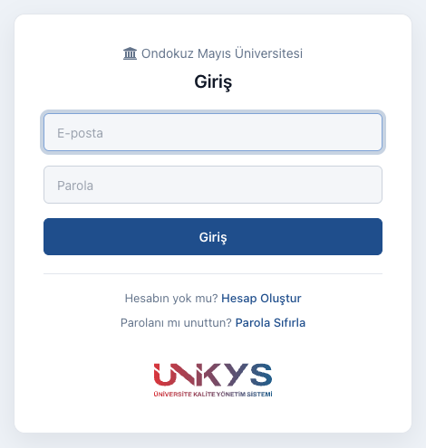

# Sisteme Giriş

Bu sayfada sisteme giriş, hesap oluşturma ve parola işlemleri anlatılır.

## Giriş yapma {#giris-yapma}

1. Ünikys adresini tarayıcınızda açın. Giriş yapmadıysanız sağ üstteki **Giriş** bağlantısına tıklayın.
2. **Giriş** ekranında **E-posta** ve **Parola** alanlarını doldurun.
3. **Giriş** butonuna tıklayın.

{ width="360" }

Giriş yaptıktan sonra **Anasayfa** açılır. Bkz. [Arayüz Tanıtımı](arayuz.md).

## Hesap oluşturma {#hesap-olusturma}

Giriş ekranında **Hesap Oluştur** bağlantısı varsa kendi hesabınızı oluşturabilirsiniz.

1. **Giriş** ekranında **Hesap Oluştur** bağlantısına tıklayın.
2. **E-posta**, **Parola** ve **Parola (Tekrar)** alanlarını doldurun.
3. **Oluştur** butonuna tıklayın.

!!! note "Roller"
    Yeni oluşturulan hesapta herhangi bir rol yoktur. Rolünüze ait menüleri görebilmeniz için rollerinizin Admin
    tarafından atanması gerekir. Bkz. [Roller ve Yetkiler](../roller.md).

## Parolamı unuttum {#parola-sifirlama}

Giriş ekranında **Parola Sıfırla** bağlantısı varsa parolanızı e-posta ile yenileyebilirsiniz.

1. **Giriş** ekranında **Parola Sıfırla** bağlantısına tıklayın.
2. **E-posta** alanına hesabınızın e-posta adresini yazın.
3. **Sıfırla** butonuna tıklayın.
4. E-posta adresinize gelen iletideki **Parolamı değiştir** bağlantısına tıklayın.
5. Açılan **Parolamı Değiştir** ekranında **Parola** ve **Parola (Tekrar)** alanlarını doldurun.
6. **Parolamı Değiştir** butonuna tıklayın.

!!! info
    Parola sıfırlama kullanıcının kendisi tarafından e-posta ile yapılır.

## Parola değiştirme {#parola-degistirme}

Kullanıcı menüsünde **Parolamı Değiştir** seçeneği varsa parolanızı şu adımlarla değiştirebilirsiniz:

1. Sağ üstte e-posta adresinize tıklayın.
2. **Parolamı Değiştir** seçeneğine tıklayın.
3. **Parola**, **Parola (Tekrar)** ve **Mevcut Parolanız** alanlarını doldurun.
4. **Değişiklikleri Kaydet** butonuna tıklayın.

## Profil bilgilerini güncelleme {#profil}

1. Sağ üstte e-posta adresinize tıklayın.
2. **Profil** seçeneğine tıklayın.
3. **Düzenle** butonuna tıklayın.
4. **Ad Soyad**, **Kişisel E-posta**, **Cep Telefonu**, **Dahili No**, **Kadro Birimi** ve **Ünvan** alanlarını
   doldurun.
5. **Kaydet** butonuna tıklayın.

## Çıkış

Sağ üstte e-posta adresinize tıklayın ve **Çıkış** seçeneğine tıklayın.
