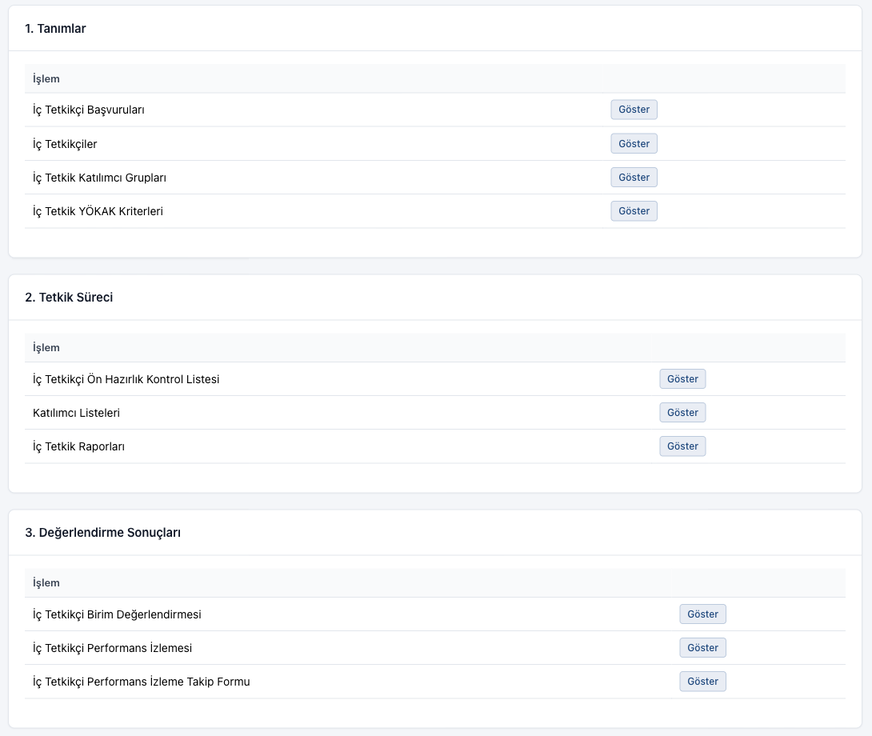
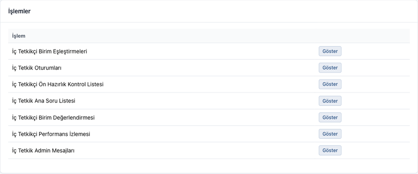

# İç Tetkik

Bu modülde iç tetkikler tanımlanır, iç tetkikçiler birimlerde tetkik yapar, iç tetkik raporları ve bulgular oluşturulur.

Aşağıdaki bölümler işlem sırasıyla yazılmıştır. Her adımda ilgili ekranın sistemdeki yeri verilmiştir.

## Bu sayfayı kimler kullanır

| Rol | Yapacağı işler |
|-----|----------------|
| Admin | [Tetkik Öncesi Admin İşlemleri](#tetkik-oncesi-admin), [Tetkik Sonrası Admin İşlemleri](#tetkik-sonrasi-admin) |
| İç tetkikçi olmak isteyen kullanıcı | [İç Tetkikçi Başvurusu](#ic-tetkikci-basvurusu) |
| İç Tetkikçi | [Katılım Başvurusu](#katilim-basvurusu), [Tetkik İşlemleri](#tetkik-islemleri), [Tetkik Sonrası İşlemler](#tetkik-sonrasi) |
| Ekip Lideri | [Tetkik İşlemleri](#tetkik-islemleri), [Tetkik Sonrası İşlemler](#tetkik-sonrasi) |
| Süreç Yöneticisi (tetkik edilen birim) | [Raporun Onaylanması](#rapor-onayi-birim), [İç Tetkikçilerin Değerlendirilmesi](#performans-izlemesi), [Bulgulardan DİF / Düzeltme](#bulgu-dif-duzeltme) |
| Kalite Sorumlusu (tetkik edilen birim) | [Bulgulardan DİF / Düzeltme](#bulgu-dif-duzeltme) |
| Üniversite Yöneticisi | Admin ekranlarını görüntüleme |

!!! info "Ekranların yeri"
    Admin ekranları iki yerden açılır:

    - **İç Tetkik** > **Genel İç Tetkik İşlemleri**: tüm iç tetkikler için ortak tanımlar ve sonuçlar. Üç panel vardır:
      **1. Tanımlar**, **2. Tetkik Süreci**, **3. Değerlendirme Sonuçları**.
    - **İç Tetkik** > **İç Tetkikler** > ilgili iç tetkikin satırında **Göster**: seçili iç tetkike ait işlemler. Bu işlemler
      **İşlemler** panelinde listelenir.

    Her iki yerde de işlemin satırındaki **Göster** butonu ilgili ekranı açar.

---

## Tetkik Öncesi Admin İşlemleri {#tetkik-oncesi-admin}

!!! note "Rol"
    Admin

Başvuru ve iç tetkikçi işlemleri ile aşağıdaki 1. ve 2. adımlar **Genel İç Tetkik İşlemleri** ekranındaki **1. Tanımlar**
panelinden yapılır:

### İç Tetkikçi Başvurularının Değerlendirilmesi

1. **İç Tetkik** > **Genel İç Tetkik İşlemleri** menüsüne girin.
2. **1. Tanımlar** panelinde **İç Tetkikçi Başvuruları** satırındaki **Göster** butonuna tıklayın.
3. İncelemek istediğiniz başvuruyu **Göster** ile açın.
4. **Durumunu Güncelle** listesinden **İnceleniyor**, **Onaylandı** veya **Reddedildi** seçeneğini seçin.
   - **Reddedildi** seçildiğinde açılan **Başvuruyu Reddet** penceresinde **Ret Açıklaması** alanını doldurup **Reddet**
     butonuna tıklayın.

Başvurusu onaylanan kişi **İç Tetkikçiler** listesine eklenir.

### İç Tetkikçiyi Doğrudan Ekleme

1. **İç Tetkik** > **Genel İç Tetkik İşlemleri** menüsüne girin.
2. **1. Tanımlar** panelinde **İç Tetkikçiler** satırındaki **Göster** butonuna tıklayın.
3. **İç Tetkikçi Oluştur** butonuna tıklayın.
4. Şu alanları doldurun: **Ad Soyad**, **E-posta**, **Kadro Birimi**, **Ünvan**, **Cep Telefonu**, **Sertifika(lar)**.
   Varsa **İç Tetkikçi Başvurusu** alanını da seçin.
5. **Oluştur** butonuna tıklayın.

### 1. İç Tetkik YÖKAK Kriterleri

1. **İç Tetkik** > **Genel İç Tetkik İşlemleri** menüsüne girin.
2. **1. Tanımlar** panelinde **İç Tetkik YÖKAK Kriterleri** satırındaki **Göster** butonuna tıklayın.
3. **İç Tetkik YÖKAK Ölçütü Oluştur** butonuna tıklayın.
4. **YÖKAK Ölçütü** ve **Durumu** alanlarını doldurun.
5. **Oluştur** butonuna tıklayın. Her ölçüt için tekrarlayın.

### 2. İç Tetkik Katılımcı Grupları

1. **İç Tetkik** > **Genel İç Tetkik İşlemleri** menüsüne girin.
2. **1. Tanımlar** panelinde **İç Tetkik Katılımcı Grupları** satırındaki **Göster** butonuna tıklayın.
3. **İç Tetkik Katılımcı Grubu Oluştur** butonuna tıklayın.
4. **Katılımcı Grubu** ve **Durumu** alanlarını doldurun.
5. **Oluştur** butonuna tıklayın. Her grup için tekrarlayın.

### İç Tetkik Oluşturma

1. **İç Tetkik** > **İç Tetkikler** menüsüne girin.
2. **İç Tetkik Oluştur** butonuna tıklayın.
3. Şu alanları doldurun: **İç Tetkik Adı**, **Yıl**, **Durumu**, **Katılım Listesi Dokümanı**.
4. **Oluştur** butonuna tıklayın.

!!! tip "Önceki iç tetkikten aktarma"
    Yeni iç tetkiki önceki bir iç tetkikin tanımlarından da oluşturabilirsiniz:

    1. **İç Tetkik** > **İç Tetkikler** menüsünde **Önceki İç Tetkikten Aktar** butonuna tıklayın.
    2. **Kaynak İç Tetkik**, **İç Tetkik Adı** ve **Yıl** alanlarını doldurun.
    3. **İşlemler** bölümünde aktarılacakları işaretleyin.
    4. **Yeni İç Tetkik Oluştur** butonuna tıklayın.

    Aktarılan iç tetkik **Pasif** durumda oluşur. Aşağıdaki 3–9. adımlarda aktarılan kayıtları kontrol edip gerekirse
    düzenleyin.

Aşağıdaki 3–9. adımlar seçili iç tetkik üzerinde yapılır. Her biri için önce **İç Tetkik** > **İç Tetkikler** menüsüne girin,
ilgili iç tetkikin satırında **Göster** butonuna tıklayın ve **İşlemler** panelindeki ilgili satırın **Göster** butonunu açın.

### 3. İç Tetkik Oturumları

1. **İşlemler** panelinde **İç Tetkik Oturumları** satırında **Göster** butonuna tıklayın.
2. **İç Tetkik Oturumu Oluştur** butonuna tıklayın.
3. **Oturum Adı** ve **Katılımcı Grupları** alanlarını doldurun.
4. **Oluştur** butonuna tıklayın.

### 4. İç Tetkikçi Ön Hazırlık Kontrol Listesi

1. **İşlemler** panelinde **İç Tetkikçi Ön Hazırlık Kontrol Listesi** satırında **Göster** butonuna tıklayın.
2. **İç Tetkikçi Ön Hazırlık Kontrol Listesi Kriteri Oluştur** butonuna tıklayın.
3. **Kriter No** ve **Kriter** alanlarını doldurun.
4. **Oluştur** butonuna tıklayın.

### 5. İç Tetkik Ana Soru Listesi

1. **İşlemler** panelinde **İç Tetkik Ana Soru Listesi** satırında **Göster** butonuna tıklayın.
2. **İç Tetkik Sorusu Oluştur** butonuna tıklayın.
3. Şu alanları doldurun:
   - **Soru No**, **Soru**, **Açıklama**
   - **İlgili ISO 9001/10002 Maddesi**
   - **Katılımcı Grupları**, **İlgili YÖKAK Ölçütü**, **İlgili Süreç**
   - **Yetersizlik Bulgu Türü**
4. **Oluştur** butonuna tıklayın.

### 6. İç Tetkikçi Birim Değerlendirmesi

1. **İşlemler** panelinde **İç Tetkikçi Birim Değerlendirmesi** satırında **Göster** butonuna tıklayın.
2. **İç Tetkikçi Birim Değerlendirmesi Kriteri Oluştur** butonuna tıklayın.
3. **Kriter No** ve **Kriter** alanlarını doldurun.
4. **Oluştur** butonuna tıklayın.

### 7. İç Tetkikçi Performans İzlemesi

1. **İşlemler** panelinde **İç Tetkikçi Performans İzlemesi** satırında **Göster** butonuna tıklayın.
2. **İç Tetkikçi Performans Sorusu Oluştur** butonuna tıklayın.
3. **Soru** ve **Değerlendiren** alanlarını doldurun.
4. **Oluştur** butonuna tıklayın.

### 8. İç Tetkik Admin Mesajları

1. **İşlemler** panelinde **İç Tetkik Admin Mesajları** satırında **Göster** butonuna tıklayın.
2. **İç Tetkik Admin Mesajları Oluştur** butonuna tıklayın.
3. Şu alanları doldurun:
   - **İç Tetkik Kontrol Listesi Ekranı Mesajı**
   - **İç Tetkik Ekranı Mesajı**
   - **İç Tetkikçi Birimi Değerlendirme Ekranı Mesajı**
   - **İç Tetkikçi Değerlendirme Ekranı Mesajı**
4. **Oluştur** butonuna tıklayın.

### 9. İç Tetkikçi Birim Eşleştirmeleri

1. **İşlemler** panelinde **İç Tetkikçi Birim Eşleştirmeleri** satırında **Göster** butonuna tıklayın.
2. **İç Tetkikçi Birim Eşleştirmesi Oluştur** butonuna tıklayın.
3. Şu alanları doldurun: **Birim**, **Ekip Lideri**, **İç Tetkikçi**, **Oturumlar**, **Başlangıç Tarihi**,
   **Bitiş Tarihi**.
4. **Oluştur** butonuna tıklayın. Tetkik edilecek her birim için tekrarlayın.

Eşleştirme listesini **Excel Dosyası Olarak İndir** butonuyla indirebilirsiniz.

### Katılım Başvurularını Açma ve Kapatma

İç tetkikçilerin bu iç tetkike katılım durumlarını bildirebilmeleri için başvuruları açın:

1. **İç Tetkik** > **İç Tetkikler** menüsünde ilgili iç tetkikin satırında **Göster** butonuna tıklayın.
2. **İç Tetkikçi Katılım Başvuruları** panelinde **Başvuruları Al** butonuna tıklayın.
3. Gelen yanıtları aynı panelde izleyin.
4. Başvuru süresi bittiğinde **Başvuruları Kapat** butonuna tıklayın.

---

## İç Tetkikçi Başvurusu {#ic-tetkikci-basvurusu}

!!! note "Rol"
    İç tetkikçi olmak isteyen kullanıcı

1. **İç Tetkik** > **İç Tetkikçi Başvurusu Yap** menüsüne girin.
2. Şu alanları doldurun: **Ad Soyad**, **Kadro Birimi**, **Ünvan**, **Cep Telefonu**, **Sertifika Var Mı?**,
   **Sertifika(lar)**, **Deneyimler**.
3. **Oluştur** butonuna tıklayın.

Başvurunuzun durumunu **İç Tetkik** > **İç Tetkikçi Başvuruları** menüsünden izleyebilirsiniz.

## Katılım Başvurusu {#katilim-basvurusu}

!!! note "Rol"
    İç Tetkikçi

Admin bir iç tetkik için başvuruları açtığında:

1. **İç Tetkik** > **İç Tetkik Katılım Başvurusu** menüsüne girin.
2. **Katılım Durumunu Bildir** panelinde **İç Tetkik** alanından iç tetkiki seçin (başvurusu açık tek iç tetkik varsa
   seçili gelir) ve **Katılmak istiyorum** veya **Katılmak istemiyorum** seçeneğini seçin.
3. **Onayla** butonuna tıklayın.

Verdiğiniz yanıtlar **Katılım Başvurularım** panelinde listelenir. Başvurular açık olduğu sürece yanıtınızı
değiştirebilirsiniz.

---

## Tetkik İşlemleri {#tetkik-islemleri}

!!! note "Rol"
    İç Tetkikçi, Ekip Lideri

Bütün tetkik işlemleri **İç Tetkik** > **İç Tetkikçi Görevlerim** menüsünden yapılır. Sol tarafta
**İç Tetkik Yapılacak Birimler** listelenir; işlem yapacağınız birimi seçin. Birimin sayfası üç bölümden oluşur:
**1. Tetkik Öncesi İşlemler**, **2. Tetkik Esnasında Gerçekleştirilecek İşlemler**, **3. Tetkik Sonrası İşlemler**.

### Tetkik Öncesi: Ön Hazırlık Kontrol Listesi

!!! note "Rol"
    Ekip Lideri

1. **1. Tetkik Öncesi İşlemler** bölümünde **İç Tetkikçi Ön Hazırlık Kontrol Listesi Kriterlerini Cevapla** butonuna tıklayın.
2. Her kriteri yanıtlayın ve **Birime Ait Genel Değerlendirme** alanını doldurun.
3. **Oluştur** butonuna tıklayın.

Ekip lideri cevaplamadan önce iç tetkikçiler listeyi **İç Tetkikçi Ön Hazırlık Kontrol Listesini Göster** butonuyla
görüntüler; cevaplandıktan sonra herkes **İç Tetkikçi Ön Hazırlık Kontrol Listesi Cevaplarını Göster** butonunu görür. Birimin raporları
**Birim Raporlarını Göster** butonuyla açılır.

### Tetkik Esnasında: Oturumlar

!!! info "İşlem sırası"
    Oturumlar, ön hazırlık kontrol listesi cevaplandıktan sonra başlatılabilir. Katılımcı listesi ve iç tetkik raporu,
    tüm oturumlar kaydedildikten sonra oluşturulabilir.

1. **2. Tetkik Esnasında Gerçekleştirilecek İşlemler** bölümünde ilgili oturumun satırındaki **Oturumu Başlat** butonuna
   tıklayın.
2. Her soru için **Bilgi Düzeyi** alanında **İyi**, **Orta** veya **Yetersiz** seçeneğini seçin.
   Gerekirse **Tetkikçi Değerlendirme Notu** alanını doldurun.
3. **Genel Değerlendirme** alanını doldurun. Varsa **Kanıtlar (varsa)** alanından dosya yükleyin.
4. **Oluştur** butonuna tıklayın.

Kaydedilen oturum **Oturumu Göster** butonuyla açılır.

### Tetkik Esnasında: Katılımcı Listesi

1. **Katılımcı Listesi Yükle** butonuna tıklayın.
2. Gerekirse katılım listesi şablonunu **Doğrudan İndir** bağlantısından indirin.
3. **Katılımcı Sayısı** alanını doldurun ve imzalı listeyi yükleyin.
4. **Oluştur** butonuna tıklayın.

### İç Tetkik Raporu ve Bulgular

1. **İç Tetkik Raporu Oluştur** butonuna tıklayın.
2. **İç Tetkik Yapılan Birim** alanı dolu gelir. **Tetkike Ait Gözlemler Ve Genel Değerlendirme** alanını doldurun.
3. Her bulgu için **Bulgu Oluştur** butonuna tıklayın.
   - Oturumlarda **Yetersiz** işaretlenen soru varsa açılan pencerede **Bu Sorudan Bulgu Oluştur** veya
     **Boş Bulgu Oluştur** seçeneğini seçin.
4. Bulgu alanlarını doldurun:
   - **YÖKAK Ölçütü**, **Bulgu Tanımı**
   - **Uygunsuzluğun Tarifi Ve Yapılacak Faaliyet**, **Yapılacak Faaliyet**
   - **Sorumlu**, **Planlanan Bitiş Tarihi**, **İlgili Süreç**
5. **Oluştur** butonuna tıklayın.

### Raporun Onaylanması

1. Raporu **İç Tetkik Raporunu Göster** butonuyla açın.
2. **Raporu Onayla** butonuna tıklayın.

Rapor sırasıyla iç tetkikçiler, ekip lideri ve tetkik edilen birimin Süreç Yöneticisi tarafından onaylanır.

---

## Tetkik Sonrası İşlemler {#tetkik-sonrasi}

### İç Tetkikçi Birim Değerlendirmesi

!!! note "Rol"
    Ekip Lideri

1. **İç Tetkik** > **İç Tetkikçi Görevlerim** menüsünde birimi seçin.
2. **3. Tetkik Sonrası İşlemler** bölümünde **İç Tetkikçi Birim Değerlendirmesi Kriterlerini Cevapla** butonuna tıklayın.
3. Her kriteri yanıtlayın ve **Birime Ait Görüş Ve Önerileriniz** alanını doldurun.
4. **Oluştur** butonuna tıklayın.

Ekip lideri cevaplamadan önce iç tetkikçiler formu **İç Tetkikçi Birim Değerlendirmesi Formunu Göster** butonuyla
görüntüler; cevaplandıktan sonra herkes **İç Tetkikçi Birim Değerlendirmesi Cevaplarını Göster** butonunu görür.

### Raporun Birim Tarafından Onaylanması {#rapor-onayi-birim}

!!! note "Rol"
    Süreç Yöneticisi (tetkik edilen birim)

1. **İç Tetkik** > **İç Tetkik Raporları** menüsüne girin.
2. İlgili raporu **Göster** ile açın.
3. **Raporu Onayla** butonuna tıklayın.

### İç Tetkikçilerin Değerlendirilmesi {#performans-izlemesi}

!!! note "Rol"
    Süreç Yöneticisi (tetkik edilen birim)

Rapor onaylandıktan sonra, iç tetkik **Aktif** durumdayken:

1. **İç Tetkik** > **İç Tetkikçi Performans İzlemesi** menüsüne girin.
2. **Değerlendirme Bekleyen İç Tetkikçiler** tablosunda değerlendireceğiniz kişinin satırındaki **Puanla** butonuna
   tıklayın.
3. Soruları yanıtlayın ve **Açıklama ve Öneriler** alanını doldurun.
4. **Oluştur** butonuna tıklayın. Birime gelen her iç tetkikçi için tekrarlayın.

### Bulgulardan DİF / Düzeltme {#bulgu-dif-duzeltme}

!!! note "Rol"
    Süreç Yöneticisi, Kalite Sorumlusu (tetkik edilen birim)

Onaylanan raporda bulgu varsa:

1. **İç Tetkik** > **İç Tetkik Raporları** menüsünde raporu **Göster** ile açın.
2. Bulgular tablosunda ilgili bulgunun satırındaki **Göster** butonuna tıklayın.
3. Bulgu türüne göre **DİF Oluştur** veya **Düzeltme Yap** butonuna tıklayın.

Formların doldurulması [İyileştirme Yönetimi](iyilestirme.md) sayfasında anlatılmıştır.

---

## Tetkik Sonrası Admin İşlemleri {#tetkik-sonrasi-admin}

!!! note "Rol"
    Admin (Üniversite Yöneticisi görüntüleyebilir)

Aşağıdaki ekranların hepsi **İç Tetkik** > **Genel İç Tetkik İşlemleri** menüsünden, ilgili satırdaki **Göster** butonuyla
açılır.

| Ekran | Panel |
|---|---|
| **İç Tetkikçi Ön Hazırlık Kontrol Listesi**: ekip liderlerinin ön hazırlık cevapları | **2. Tetkik Süreci** |
| **Katılımcı Listeleri**: tetkiklerde yüklenen imza listeleri | **2. Tetkik Süreci** |
| **İç Tetkik Raporları** | **2. Tetkik Süreci** |
| **İç Tetkikçi Birim Değerlendirmesi**: ekip liderlerinin birim değerlendirmeleri. **Excel Dosyası Olarak İndir** ile indirilebilir. | **3. Değerlendirme Sonuçları** |
| **İç Tetkikçi Performans İzlemesi**: birimlerin iç tetkikçi değerlendirmeleri | **3. Değerlendirme Sonuçları** |
| **İç Tetkikçi Performans İzleme Takip Formu**: iç tetkikçilerin performans sonuçları. **Excel Dosyası Olarak İndir** ile indirilebilir. | **3. Değerlendirme Sonuçları** |

İç tetkik raporları için ayrıca [Raporlar](raporlar.md) sayfasındaki iç tetkik raporlarına bakınız: **İç Tetkik İstatistikleri**,
**İç Tetkik Bulgu ve Takip Çizelgesi**, **Birim İç Tetkik Raporu**.
